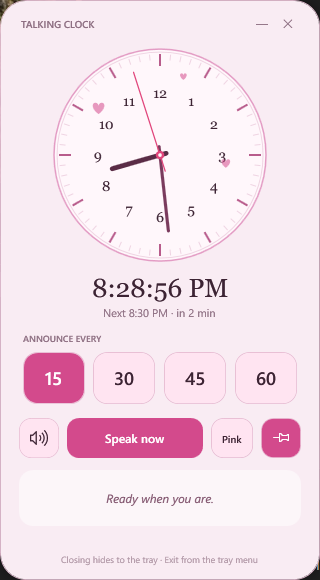

# SoliloClock

A small, offline Windows tray talking clock. SoliloClock announces the time on a
15, 30, 45 or 60 minute cadence, sometimes following it with an original
`fortune`-style line. It is a native C#/WPF utility: no browser runtime, no
account, no telemetry, no network access.



The project plan lives in [`doc/plan.md`](doc/plan.md) and current progress is
tracked in [`STATUS.md`](STATUS.md).

## Status

The M0 skeleton and M1 "minimum lovable product" are implemented:

- Animated vector analog clock and digital readout.
- Four interval buttons: **15**, **30**, **45**, **60**.
- Windows SAPI speech, **Speak now**, mute, and an English announcement formatter.
- Wall-clock scheduling with explicit anchored 45-minute semantics; missed
  announcements after sleep/resume are skipped rather than replayed.
- Five bundled themes: Pink, Blue, Black, Neon, Transparent.
- Tray icon with interval, mute, theme, options, show and exit commands; close
  hides to tray with a one-time explanation.
- Single-instance behavior; a second launch reveals the existing clock.
- 100-line English phrase catalog at a 25% joke rate with no repeats in the last
  20 selections.
- Settings persisted atomically to `%APPDATA%\SoliloClock\settings.json`.
- **M2.1 localization foundation:** per-locale UI string catalogs, an independent
  speech language, a locale-keyed time-formatter factory, an installed-voice picker
  with **Test voice**, RTL/language plumbing, and grapheme-safe tray text.
- **Automatic language** from the Windows display language, with live overrides in
  tray **Options → Language** and **Options → Announce in**.
- **M2.2 complete — six Western European languages:** French (`fr-FR`), German
  (`de-DE`), Spanish (`es-ES`), Italian (`it-IT`), Dutch (`nl-NL`) and Portuguese
  (`pt-PT`) each ship a UI catalog, 100 phrases and their own time grammar
  ("il est neuf heures et quart", "halb zehn", "son las nueve y cuarto", "sono le nove
  e mezza", "het is half tien", "são nove horas e um quarto").
- **Welsh (`cy-GB`), provisional:** UI catalog, 100 phrases and a Welsh time formatter
  ("mae'n dri o'r gloch", "chwarter wedi naw", "hanner awr wedi naw", "chwarter i
  ddeg"). The wording is machine-drafted, so both language menus label it *draft —
  pending native review* until a Welsh speaker has reviewed it.
- **M2.3 complete — Polish, Russian and Greek:** `pl-PL`, `ru-RU` and `el-GR` each ship
  a UI catalog, 100 phrases and their own time grammar ("jest wpół do dziesiątej",
  "без четверти десять", "εννέα και τέταρτο"), with Polish and Russian plural and
  case agreement covered by tests.
- **M2.7 worldwide expansion in progress — 21 locales shipped:** the original plan's
  seventeen finished with Arabic (`ar`), Hindi (`hi`), both Chinese scripts, Japanese
  (`ja-JP`) and Korean (`ko-KR`); M2.7 then targets every language Windows itself can
  speak. Danish (`da-DK`), Swedish (`sv-SE`), Norwegian Bokmål (`nb-NO`) and Czech
  (`cs-CZ`) now ship complete packs ("Klokken er kvart over ni", "Klockan är halv
  tio", "Klokka er kvart på ti", "Je tři čtvrtě na deset"), leaving fifteen of the
  Windows-voice languages still to add.
- **Draft marker:** every machine-drafted pack (`cy-GB`, `ar`, `hi`, `zh-Hans`,
  `zh-Hant`, `ja-JP`, `ko-KR`, `da-DK`, `sv-SE`, `nb-NO`, `cs-CZ`) appears in both
  language menus with a *draft — pending native review* marker. Chinese regions pick
  their script automatically (`zh-CN` → Simplified, `zh-TW`/`zh-HK` → Traditional),
  and the tray menu and close-to-tray dialog mirror for Arabic.

Not yet implemented: the rest of M2.7 (Turkish, Hungarian, Romanian, Croatian,
Bulgarian, Slovak, Finnish, Slovenian, Catalan, Hebrew, Indonesian, Malay, Thai,
Vietnamese and Tamil), quiet hours, usage reminders, tone/category settings UI,
diagnostics page, installer (M3/M4). Welsh is usable but explicitly a draft, not a
finished translation.

## Requirements

- Windows 10 or Windows 11.
- .NET 10 SDK or newer (built with 10.0.404) and the .NET 10 Desktop Runtime for
  a framework-dependent build.
- A Windows speech voice for audio. The clock still runs and shows captions when
  no voice is installed.

> **Support-lifecycle note:** the project targets `net10.0-windows`, the current
> LTS (supported to November 2028). It was retargeted from `net9.0-windows` after
> .NET 9 left support in May 2026; only the TFM and the `System.Speech` package
> version changed, not the code.

## Build, run, test

```powershell
dotnet build SoliloClock.sln -c Release
dotnet run --project src/SoliloClock.App
dotnet test test/SoliloClock.Tests/SoliloClock.Tests.csproj
```

or use the helper scripts:

```powershell
pwsh tools/build.ps1          # builds Release, then runs the tests
pwsh tools/publish.ps1        # self-contained win-x64 single file in artifacts/
pwsh tools/publish.ps1 -FrameworkDependent
```

To hear the other languages on a test machine:

```powershell
pwsh local/install-all-packs.ps1            # report which voice can speak each language
pwsh local/install-all-packs.ps1 -Install   # add and expose Windows voices (elevated)
```

The publish script produces `artifacts/<runtime>/SoliloClock.exe`. A
self-contained build needs the matching runtime pack to be downloadable the
first time.

## Using SoliloClock

- **Intervals** are cadences, not polling loops. **15** announces at `:00`,
  `:15`, `:30`, `:45`; **30** at `:00` and `:30`; **60** on the hour.
- **45** announces every 45 elapsed minutes from the moment it was selected
  (for example 10:07 → 10:52 → 11:37). The anchor is kept across restarts.
- Only one announcement fires per boundary. Advancing the clock, changing
  timezone/DST, resuming from sleep or unlocking reschedules from *now*; a
  boundary missed by more than 90 seconds is dropped, not replayed.
- **Mute** silences scheduled announcements only. The clock keeps animating, and
  **Speak now** is always explicit and still speaks.
- **Speak now** speaks the current time immediately and may include a line from
  the phrase catalog, per the joke rate.
- **Close** hides the window to the tray and explains this the first time.
  **Exit** is in the tray menu. Left-clicking the tray icon shows the clock.
- The theme chip cycles all five themes; the tray menu also lists them. In the
  **Transparent** theme an opacity slider appears. **Always on top** is the pin
  button (also in tray Options).
- **Reduced motion** is in tray Options. It is also forced on when Windows
  reports animations are disabled. When hidden, the clock stops rendering
  entirely; announcements continue.
- Right-click the tray icon for the next scheduled announcement. Tray tooltip
  shows the current theme and next time.

## Themes

| Theme | Personality |
|---|---|
| Pink | Rose and lilac card, soft sparkles and hearts. |
| Blue | Cobalt/sky-blue card, sporty hands. |
| Black | Near-black graphite card, steel typography. |
| Neon | Dark navy with pulsing cyan/magenta glow. |
| Transparent | Translucent floating clock with adjustable opacity. |

Themes only change appearance; they do not affect voice or language.

## Speech and languages

Speech uses Windows SAPI through `System.Speech`. The voice list is whatever
Windows actually has installed, shown with the culture each voice speaks;
`Options → Voice` offers **Test voice** and states outright when no installed
voice can speak the selected language. The app never claims a language can speak
without a compatible voice, and never lets an English voice pronounce French text
just because it happened to be the last one used.

With no voice pinned, the app announces with an installed voice that speaks the
announcement language — exact region first, then any voice of that language,
otherwise the Windows default — so switching `Announce in` to French speaks with a
French voice. The choice is re-resolved on every announcement, so installing a
voice later needs no restart, and *Automatic* in the voice menu names what it
picks.

The UI and announcements ship in English (`en-GB`), French (`fr-FR`), German
(`de-DE`), Spanish (`es-ES`), Italian (`it-IT`), Dutch (`nl-NL`), Portuguese
(`pt-PT`), Polish (`pl-PL`), Russian (`ru-RU`), Greek (`el-GR`), Arabic (`ar`),
Danish (`da-DK`), Swedish (`sv-SE`), Norwegian Bokmål (`nb-NO`), Czech (`cs-CZ`),
Arabic (`ar`), Hindi (`hi`), Simplified Chinese (`zh-Hans`), Traditional Chinese
(`zh-Hant`), Japanese (`ja-JP`), Korean (`ko-KR`) and Welsh (`cy-GB`). Localization is delivered in language
stages (see `doc/plan.md` §14): a language ships only once its UI catalog, its own
time grammar with tests, and an adapted phrase catalog exist, so nothing appears in
the picker half-finished. Welsh, Arabic, both Chinese packs and Japanese are
machine-drafted, so each appears in both language menus with a *draft — pending
native review* marker until a native speaker has checked it. The packs authored
for this project (French, German, Spanish, Italian, Dutch, Portuguese, Polish,
Russian, Greek) are not marked but still need a native speaker's review.

To *hear* Welsh you need a Welsh SAPI voice, which Windows does not include.
Install [Techiaith TTS](https://techiaith.cymru/en/products/techiaith-tts/) (free,
offline, from Bangor University's Language Technologies Unit); it registers as a
SAPI 5 voice and then appears in **Options → Voice** as `cy-GB`. Voices are a
machine-level install: they are never bundled with SoliloClock or committed to
this repository.

Windows keeps many of its voices in a newer speech stack that SAPI 5 never lists,
so a language Windows itself can speak can still be missing from
**Options → Voice**. `local/install-all-packs.ps1` closes that gap for testing:
`-Install` adds the Windows text-to-speech feature for each shipped language and
copies those voice tokens into the SAPI 5 tree — the same bridge
Microsoft uses for its own English voices. It needs an elevated 64-bit PowerShell
and Windows Update access, records exactly which tokens it created, and `-Remove`
deletes only those. Welsh still needs Techiaith TTS, which the same script can
install with `-VoicePack`.

Language needs no setup: `UiLanguage` is `null` by default, which means follow the
Windows display language. Automatic resolution picks the best shipped catalog for
that language — `fr-CA` uses `fr-FR`, and a language with no catalog uses English
and says so in the status line rather than mixing languages silently.

Both languages are overridable independently, and the tray picker applies changes
live:

```json
// %APPDATA%\SoliloClock\settings.json
{ "UiLanguage": null, "SpeechLanguage": null }
```

`SpeechLanguage: null` follows the interface language; set it to a tag to keep the
window in one language and speak another. `"auto"`, `"system"` and unknown tags are
treated as automatic.

If no voice is available, the app still starts, shows the last spoken text as a
caption, and explains the situation in the status line and a tray balloon.

## Phrase catalog

`src/SoliloClock.App/Resources/Phrases/` holds one catalog per shipped language:
`en-GB.json`, `fr-FR.json`, `de-DE.json`, `es-ES.json`, `it-IT.json`, `nl-NL.json`,
`pt-PT.json`, `pl-PL.json`, `ru-RU.json`, `el-GR.json`, `da-DK.json`, `sv-SE.json`,
`nb-NO.json`, `cs-CZ.json`, `ar.json`, `hi.json`, `zh-Hans.json`, `zh-Hant.json`,
`ja-JP.json`, `ko-KR.json` and provisional `cy-GB.json`, each with 100 lines sharing the same ids and metadata (a shared test
enforces the parity). English is the reference catalog; every other pack was written
for this project and would still benefit from a native speaker's review. Welsh,
Arabic, Hindi, both Chinese packs, Japanese and Korean are flagged as drafts in the UI. Fields per entry: `id`, `text`, `category`, `tone`,
`weight`, `familyFriendly`, `minActiveMinutes`, `timeWindow`.

Selection:

- Time is always announced first; a joke is an optional extra sentence.
- Default 25% joke rate (0/10/25/50/100 supported by settings).
- Weighted random selection, no repeat of a phrase in the last 20 picks.
- Tone presets: polite (polite lines only), cheeky (polite + cheeky), unhinged
  (all). Default cheeky.
- Day-part windows keep morning/afternoon/evening/late-night lines in context.
- `minActiveMinutes` is gated on app-observed elapsed session time since launch,
  not on invented computer usage. v1 has one three-hour break line.
- Invalid or duplicate entries are skipped with diagnostics; the rest load.
- The family-friendly flag is honoured; all bundled lines currently pass it.

## Settings

`%APPDATA%\SoliloClock\settings.json`, written atomically via a temp file and
replace. A malformed file is backed up as `settings.invalid-<timestamp>.json`
and defaults are used. Values are validated and clamped on load. The app never
needs administrator rights and writes nowhere else.

## Repository layout

```text
SoliloClock.sln
src/SoliloClock.App/       WPF app, themes, phrase resources, tray, services
test/SoliloClock.Tests/    xUnit tests for scheduler, settings, phrases, formatting
tools/                     build and publish scripts
doc/plan.md                Product specification
```
